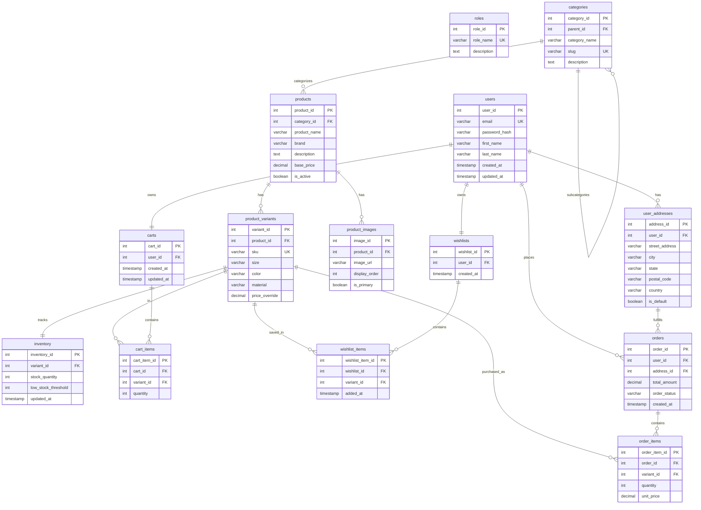

# Entity Relationship Diagram (ERD) Specification: Clothing E-Commerce Website

| Field | Details | 
| ----- | ----- | 
| **Document Title** | Entity Relationship Diagram & Schema Topology Specification | 
| **Document ID** | DOC-DB-004 | 
| **Version** | 1.0 | 
| **Status** | Draft / Pending Review | 
| **Prepared By** | Senior Database Architect | 
| **Review Status** | Pending Stakeholder Approval | 

## 1. Document Control

* **Project Name:** Clothing E-Commerce Website

* **Target Technology Stack:** MySQL 8.x, SQLAlchemy ORM

* **Document Purpose:** To define the structural entity relationship topology, cardinality, foreign key mappings, and Mermaid ERD visualization for all approved database tables.

## 2. Revision History

| Version | Date | Author | Description / Changes | 
| ----- | ----- | ----- | ----- | 
| 1.0 | 2026-06-06 | Senior Database Architect | Initial ERD specification matching approved Database Schema Design and Data Dictionary. | 

## 3. ERD Overview

This document provides the visual and structural blueprint of the MySQL relational database architecture. The system utilizes normalized tables adhering to Third Normal Form (3NF) to support user management, role-based access control, hierarchical product categories, variant-level clothing attributes, inventory tracking, active carts, wishlists, and order fulfillment.

## 4. Complete Entity List

* `users`: Stores user login credentials, password hashes, and profiles.

* `roles`: Defines system access roles for RBAC.

* `user_addresses`: Stores shipping and billing addresses for customers.

* `categories`: Organizes clothing into hierarchical multi-level categories.

* `products`: Stores master clothing product details and base metadata.

* `product_variants`: Tracks specific clothing attributes (Size, Color, Material) and SKUs.

* `product_images`: Stores image asset URLs and display orders.

* `inventory`: Manages real-time stock levels bound to variant SKUs.

* `carts`: Manages active customer shopping cart sessions.

* `cart_items`: Captures line items within active shopping carts.

* `wishlists`: Stores saved items for registered customers.

* `wishlist_items`: Line items associated with customer wishlists.

* `orders`: Records completed checkout transactions and fulfillment status.

* `order_items`: Captures permanent line-item snapshots for each order.

## 5. Entity Relationships & Cardinality Matrix

| Parent Entity | Child Entity | Relationship | Cardinality | Foreign Key | Business Rule | 
| ----- | ----- | ----- | ----- | ----- | ----- | 
| `users` | `user_addresses` | Has Addresses | One-to-Many | `user_id` | A customer can maintain multiple shipping and billing addresses. | 
| `users` | `carts` | Owns Cart | One-to-One | `user_id` | Each registered customer maintains one active shopping cart session. | 
| `users` | `wishlists` | Owns Wishlist | One-to-One | `user_id` | Each registered customer maintains one active wishlist container. | 
| `users` | `orders` | Places Orders | One-to-Many | `user_id` | A registered customer can place multiple order transactions over time. | 
| `user_addresses` | `orders` | Fulfills Order | One-to-Many | `address_id` | Each order references a specific snapshot shipping address. | 
| `categories` | `categories` | Subcategory Tree | Self-Referencing | `parent_id` | Categories can have subcategories for multi-level clothing navigation. | 
| `categories` | `products` | Categorizes | One-to-Many | `category_id` | A category can contain multiple clothing products. | 
| `products` | `product_variants` | Has Variants | One-to-Many | `product_id` | A master product has multiple physical variants (Size/Color combinations). | 
| `products` | `product_images` | Has Media | One-to-Many | `product_id` | A clothing product can have multiple associated image assets. | 
| `product_variants` | `inventory` | Stock Level | One-to-One | `variant_id` | Each variant SKU maintains exactly one real-time inventory stock record. | 
| `product_variants` | `cart_items` | Cart Line | One-to-Many | `variant_id` | Specific variants can be added to multiple customer shopping carts. | 
| `product_variants` | `wishlist_items` | Wishlist Line | One-to-Many | `variant_id` | Specific variants can be saved across multiple customer wishlists. | 
| `product_variants` | `order_items` | Order Line | One-to-Many | `variant_id` | Purchased variants are linked permanently to order line snapshots. | 
| `carts` | `cart_items` | Cart Contents | One-to-Many | `cart_id` | A shopping cart contains multiple active cart line items. | 
| `wishlists` | `wishlist_items` | Wishlist Contents | One-to-Many | `wishlist_id` | A wishlist contains multiple saved wishlist items. | 
| `orders` | `order_items` | Order Contents | One-to-Many | `order_id` | An order record contains multiple purchased line items. | 

## 6. Mermaid ERD Visualization

## 7. Data Integrity Considerations

* **Referential Action Triggers:** Foreign key constraints utilize `RESTRICT` on parent deletions where historical data must be preserved (such as `users` and `orders`), and `CASCADE` where child entities depend entirely on parent lifecycles (such as `products` to `product_variants`).

* **Atomic Inventory Reduction:** Order placement transactions execute within SQLAlchemy session commits, ensuring stock decrements occur atomically alongside order creation.

## 8. Pending Technical Decisions

* **PTD-02:** Confirmation of database connection pool sizing and asynchronous query performance tuning via SQLAlchemy.

## 9. Approval Section

| Reviewer Name | Designation / Role | Approval Status | Date | Signature | 
| ----- | ----- | ----- | ----- | ----- | 
| *\[Pending\]* | Project Sponsor / Business Owner | **Pending Review** | — | — | 
| *\[Pending\]* | Senior Database Architect | **Pending Review** | — | — | 
